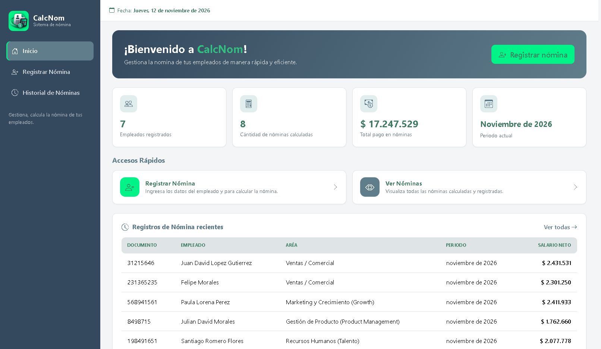
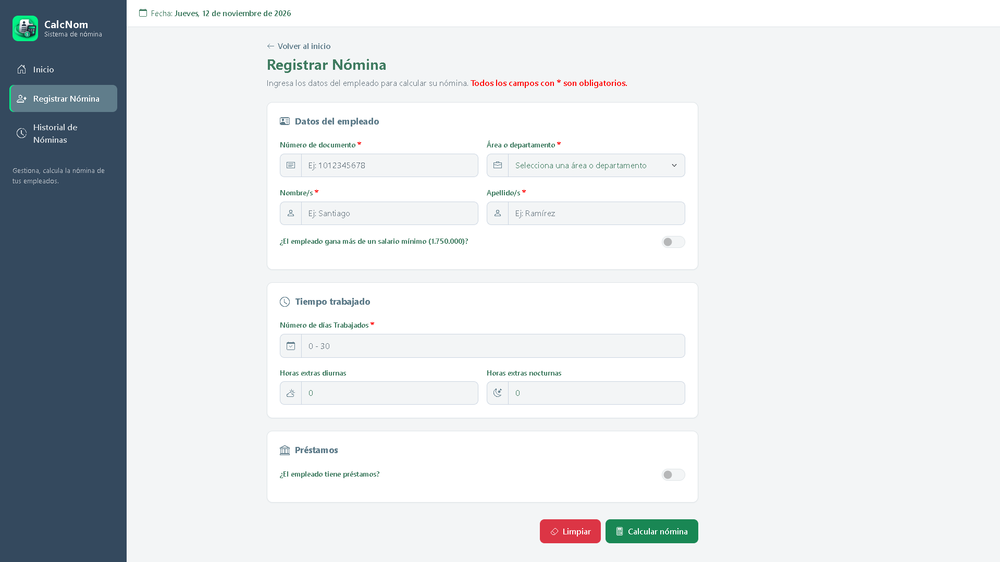
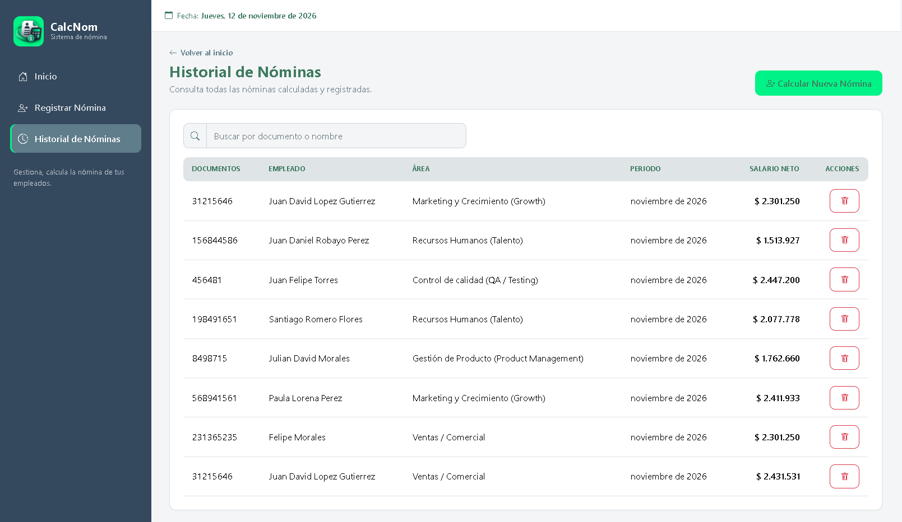

Readme · MD
<p align="center">
  
</p>
<p align="center">
  
  
  
  
  
</p>
Software web sobre el cálculo de nóminas de empleados, permite calcular y gestionar un listado de cálculos de nóminas guardados, el cálculo se realiza con valores devengados y deducidos, los cuales permiten saber el salario a pagar por el empleador, y la sumatoria de todas las nóminas para conocer el total de pago y pronosticar gastos. Este software maneja únicamente desarrollo Frontend con lenguajes HTML, CSS y JavaScript.
 
## Tabla de contenido
 
- [Herramientas utilizadas](#herramientas-utilizadas)
- [Funcionalidades](#funcionalidades)
- [Cómo funciona](#cómo-funciona)
- [Campos del formulario](#campos-del-formulario)
- [Reglas y valores del cálculo](#reglas-y-valores-del-cálculo)
- [Almacenamiento de datos](#almacenamiento-de-datos)
- [Estructura del proyecto](#estructura-del-proyecto)
- [Cómo ejecutar el proyecto](#cómo-ejecutar-el-proyecto)
- [Desarrolladores](#desarrolladores)
---
 
## Herramientas utilizadas
 
| Logo | Herramienta | Uso en el proyecto |
|:---:|---|---|
|  | **HTML5** | Estructura de las páginas (inicio, registro e historial). |
|  | **CSS3** | Estilos propios (`css/style.css`) con variables CSS para la paleta de colores. |
|  | **JavaScript (vanilla)** | Lógica de cálculo, validaciones, manejo del DOM y almacenamiento. Sin frameworks. |
|  | **Bootstrap 5.3.3** (CDN) | Rejilla, formularios, tarjetas, tablas y menú lateral responsive (offcanvas). |
|  | **Bootstrap Icons 1.13.2** (CDN) | Iconografía de la interfaz. |
|  | **localStorage** (Web Storage API) | Persistencia de las nóminas guardadas en el navegador. |
|  | **Git** | Control de versiones. |
 
El formato de moneda y fechas usa la configuración regional `es-CO` (`toLocaleString`), sin librerías externas.
 
> CalcNom es un proyecto **100 % Frontend**: no usa servidor, base de datos ni dependencias que instalar.
 
## Funcionalidades
 
### Inicio (`index.html`)
<p align="center">
  
</p>

- Saludo de bienvenida y fecha actual.
- **Indicadores generales:**
  - Empleados registrados (cuenta empleados únicos por número de documento).
  - Cantidad de nóminas calculadas.
  - Total pagado en nóminas (suma de todos los salarios netos).
  - Periodo actual (mes y año).
- **Accesos rápidos** a *Registrar Nómina* y *Ver Nóminas*.
- Tabla con las **5 nóminas más recientes**.
### Registrar nómina (`pages/registroNomina.html`)
<p align="center">
  
</p>

- Formulario para ingresar los datos del empleado.
- Campos que aparecen u ocultan según el caso (salario superior al mínimo, comisión por área, préstamo).
- Formato automático de valores monetarios (`1.750.905,50`), admite pegar valores como `1750905.50`.
- Validaciones de valores mínimos y campos obligatorios.
- **Calcular nómina:** muestra un desprendible con el detalle de devengados, deducciones y valor neto a pagar.
- **Guardar:** registra la nómina en el historial (solo se habilita después de calcular; si se modifica algún campo hay que volver a calcular).
- **Limpiar:** reinicia el formulario y oculta el resultado.
### Historial de nóminas (`pages/historialNomina.html`)
<p align="center">
  
</p>

- Listado de todas las nóminas guardadas (documento, empleado, área, periodo y salario neto).
- **Búsqueda** en tiempo real por número de documento, nombre o apellido (ignora mayúsculas y tildes).
- **Eliminar** una nómina del historial, con confirmación previa.
- Mensajes cuando no hay registros o la búsqueda no encuentra resultados.


## Cómo funciona
 
1. El usuario entra a **Registrar Nómina** y diligencia los datos del empleado.
2. Al presionar **Calcular nómina**, el sistema valida los campos y calcula:
   - **Devengados:** salario por los días trabajados, auxilio de transporte, horas extra y comisión.
   - **Deducciones:** salud, pensión y cuota del préstamo (si aplica).
   - **Nómina a pagar:** `total devengado − total deducciones`.
3. Se muestra el resultado como un desprendible al final de la página.
4. Al presionar **Guardar**, la nómina se almacena en `localStorage` y pasa a verse en el **Inicio** (indicadores y recientes) y en el **Historial**.
## Campos del formulario
 
### Obligatorios
 
| Campo | Descripción | Validación |
|---|---|---|
| Número de documento | Documento del empleado. | Texto, teclado numérico. |
| Área o departamento | Lista desplegable agrupada por área (Producto y Tecnología, Comercial y de Crecimiento, Corporativa y de Soporte). | Debe seleccionarse una opción. |
| Nombre/s | Nombres del empleado. | Texto. |
| Apellido/s | Apellidos del empleado. | Texto. |
| Días trabajados | Días laborados en el periodo. | Número entre 0 y 30. |
| Salario básico mensual (COP) | **Solo es obligatorio cuando se activa** el interruptor *"¿El empleado gana más de un salario mínimo?"*. | Mínimo `1.750.000`. |
| Monto del préstamo | **Solo es obligatorio cuando se activa** *"¿El empleado tiene préstamos?"*. | Mínimo `1`. |
| Número de cuotas | **Solo es obligatorio cuando se activa** *"¿El empleado tiene préstamos?"*. | Mínimo `1`. |
 
### Opcionales
 
| Campo | Descripción | Valor por defecto |
|---|---|---|
| ¿Gana más de un salario mínimo? | Interruptor. Si está apagado se toma el salario mínimo. | Apagado (salario mínimo) |
| Horas extras diurnas | Cantidad de horas (admite medias horas, paso `0.5`). | `0` |
| Horas extras nocturnas | Cantidad de horas (admite medias horas, paso `0.5`). | `0` |
| Comisión por ventas | Solo aparece para las áreas **Ventas / Comercial**, **Éxito del Cliente (Customer Success)**, **Preventa e Ingeniería de Soluciones** y **Marketing y Crecimiento (Growth)**. | `0` |
| ¿Tiene préstamos? | Interruptor que despliega los campos del préstamo. | Apagado |
 
## Reglas y valores del cálculo
 
**Valores estandarizados**
 
| Constante | Valor |
|---|---|
| Salario mínimo (SMMLV) | `$ 1.750.000` mensuales|
| Auxilio de transporte | `$ 250.000` mensuales |
| Horas al mes | `240` (8 horas × 30 días) |
| Recargo hora extra diurna | `+25 %` (×1,25) |
| Recargo hora extra nocturna | `+75 %` (×1,75) |
| Salud (empleado) | `4 %` |
| Pensión (empleado) | `4 %` |
 
**Fórmulas**
 

- *Salario bruto*       = (salario base / 30) × días trabajados
- *Auxilio transporte*   = (250.000 / 30) × días trabajados      (si el salario base es ≤ 2 SMMLV)
- *Valor hora*           = salario base / 240
- *Horas extra diurnas*  = valor hora × 1,25 × horas
- *Horas extra nocturnas*= valor hora × 1,75 × horas
 
- **Total devengado**      = salario bruto + auxilio transporte + Horas extra diurnas + Horas extra nocturnas + comisión
 
- *Salud*                = 4 % × total devengado
- *Pensión*              = 4 % × total devengado
- *Cuota del préstamo*   = monto del préstamo / número de cuotas
 
- **Total deducciones**    = salud + pensión + cuota del préstamo
- ***Nómina a pagar***       = total devengado − total deducciones


**Reglas**
 
- Si el empleado no gana más de un salario mínimo, el salario base es **$ 1.750.000**.
- Salud y pensión se calculan sobre el total devengado (incluye el auxilio de transporte).
- Si el resultado de la nómina es **menor o igual a cero** (por ejemplo, una cuota de préstamo demasiado alta), el sistema muestra un error y no permite calcular.
- Todos los valores se redondean al peso.


## Almacenamiento de datos
 
Las nóminas se guardan en el `localStorage` del navegador con la clave `calcnom_nominas`, como un arreglo de objetos con esta información:
 
```json
{
  "id": 1,
  "fechaRegistro": "12/11/2026",
  "periodo": "noviembre de 2026",
  "empleado": { "documento": "...", "nombre": "...", "apellido": "...", "area": "...", "...": "..." },
  "devengado": 0,
  "deducciones": 0,
  "nominaAPagar": 0
}
```
 
- El `id` es consecutivo, como en una base de datos.
- Los datos permanecen al recargar la página, pero son propios de cada navegador y equipo: borrar los datos del sitio elimina el historial.
## Estructura del proyecto
 
```text
CalcNom/
├── index.html                  # Pantalla de inicio (indicadores, accesos rápidos y recientes)
├── index.js                    # Lógica del panel de inicio y fecha
├── README.md
├── screenshots/                #Imágenes mostradas en este README.md
├── assets/
│   └── imagenes/
│       └── identidad/          # Logotipo, ícono y fondos en formato (SVG)
├── css/
│   └── style.css               # Estilos y paleta de colores
├── js/
│   ├── nomina.js               # Formulario, validaciones y cálculo de la nómina
│   ├── historialNomina.js      # Manejo del arreglo de nóminas y localStorage
│   └── historialPagina.js      # Tabla del historial, búsqueda y eliminación
└── pages/
    ├── registroNomina.html     # Formulario de registro y cálculo
    └── historialNomina.html    # Listado de nóminas guardadas
```
 
 
## Desarrolladores
 
Proyecto desarrollado por:
 
<table align="center">
  <tr>
    <td align="center" width="260">
      <br><br>
      <b>Wilson David Monroy Ramírez</b><br>
      
    </td>
    <td align="center" width="260">
      <br><br>
      <b>Luna Valentina Gómez Parra</b><br>
      
    </td>
  </tr>
</table>
